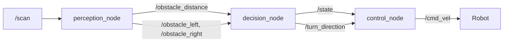
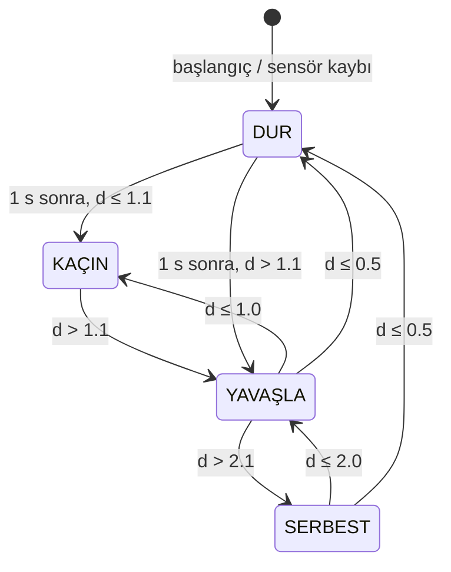

# ROS 2 Otonom Engelden Kaçınma Sistemi 🚗🤖

Bu proje, otonom araç sistemlerinin temelini oluşturan **Algılama-Karar-Kontrol (Perception-Planning-Control)** döngüsünü kavramak ve ROS 2, C++, GitHub entegrasyonlarını pratikte uygulamak amacıyla geliştirilmiştir.

Gazebo simülasyon ortamında, SDF ile tanımlanmış diferansiyel sürüşlü ve LiDAR sensörlü özel bir robot modeli kullanılmaktadır. Proje, otonom araçlardaki AEB (Acil Fren) ve engelden kaçınma mantığının simüle edilmiş bir versiyonudur: robot engele yaklaştıkça yavaşlar, çok yaklaşırsa durur ve boş olan tarafa dönerek kaçınır.

## 🏗️ Sistem Mimarisi

Sistem, ROS 2 üzerinde C++ ile geliştirilen 3 temel düğümden (node) oluşmaktadır:

1. **`perception_node` (Algılama):** `/scan` topic’ine abone olur. Ön sektördeki (±30°) en yakın mesafeyi `/obstacle_distance`, sol (30°–90°) ve sağ (-90°–-30°) sektörlerdeki en yakın mesafeleri `/obstacle_left` ve `/obstacle_right` olarak yayınlar.
2. **`decision_node` (Karar):** Mesafeye göre durum belirler (SERBEST / YAVAŞLA / KAÇIN / DUR) ve `/state` olarak yayınlar. KAÇIN durumuna girerken sol/sağ mesafeyi karşılaştırıp daha boş tarafı seçer ve `/turn_direction` olarak yayınlar.
3. **`control_node` (Kontrol):** Durumu hız komutuna çevirir ve `/cmd_vel` olarak yayınlar (rampalı hızlanma, DUR'da anlık fren).



### Durum makinesi (decision_node)

| Durum | Mesafe | Doğrusal hız (v) | Açısal hız (ω) | Çıkış koşulu |
|---|---|---|---|---|
| SERBEST | > 2.0 m | 0.4 m/s | 0 | - |
| YAVAŞLA | 1.0 – 2.0 m | 0.15 m/s | 0 | d > 2.1 m |
| KAÇIN | 0.5 – 1.0 m | 0 | 0.6 rad/s | d > 1.1 m |
| DUR | < 0.5 m | 0 | 0 | 1 s sonra |



- **Histerezis:** Durumdan çıkışlara +0.1 m pay eklenir; eşik civarında durumlar arasında gidip gelme önlenir.
- **KAÇIN → DUR geçişi yoktur:** KAÇIN yerinde dönüştür (v = 0); aksi halde DUR ↔ KAÇIN döngüsü oluşurdu.
- **Dönüş yönü:** KAÇIN'a girerken sol/sağ mesafeden büyük olan taraf seçilir. Fark 0.1 m'den küçükse ya da yan sensör verisi yoksa varsayılan yön (sol) kullanılır. Yön KAÇIN boyunca sabit kalır.
- **Güvenlik:**
  - İlk veri gelene kadar durum DUR'dur.
  - `-inf` / `NaN` ölçümü "çok yakın engel" sayılır.
  - `/obstacle_distance` 0.5 s gelmezse `decision_node` DUR yayınlar; `/state` 0.5 s gelmezse `control_node` robotu durdurur.

---

## ✅ Tamamlanan Aşamalar

### Aşama 1 – Algılama
- **Versiyon Kontrolü:** GitHub reposu oluşturuldu, geliştirme adım adım commit edildi.
- **Çalışma Alanı ve Paket Kurulumu:** `ros2-obstacle-avoidance` çalışma alanı ve `ament_cmake` paketi (`rclcpp`, `sensor_msgs`, `geometry_msgs`, `std_msgs`) oluşturuldu.
- **Simülasyon Entegrasyonu:** Özel robot modeli ve engelleri barındıran Gazebo dünyası ile `ros_gz_bridge` entegrasyonu launch dosyasıyla tek komuta indirildi.
- **Algılama Düğümü:** Ön sektördeki (±30°) minimum engel mesafesi `/obstacle_distance` olarak yayınlandı.
- **`-inf` Yönetimi:** Engel LiDAR'ın minimum menzilinden (0.12 m) yakınsa gelen `-inf` değeri "çok yakın engel" olarak işlendi.

### Aşama 2 – Karar ve Kontrol
- `decision_node` ve `control_node` geliştirildi; `/scan → /cmd_vel` zinciri kapatıldı.
- Durum makinesi ROS'tan bağımsız bir başlık dosyası olarak (`include/obstacle_avoidance/avoidance_state_machine.hpp`) yazıldı ve `g++` ile birim testlerinden geçirildi.
- `autonomy.launch.py` ile simülasyon ve tüm düğümler tek komutla başlatılır hale geldi; parametreler `config/avoidance_params.yaml` içine taşındı.

### Aşama 3 – Akıllı Kaçınma ve Kapanış
- `perception_node`'a sol/sağ sektör ölçümü eklendi (`/obstacle_left`, `/obstacle_right`).
- KAÇIN durumunda robot artık her zaman sola değil, **daha boş olan tarafa** döner (`/turn_direction`).
- Yön seçimi için birim testleri eklendi (toplam 13 test grubu, 41 kontrol).
- README ve rapor güncellendi.

---

## 📁 Dosya Yapısı

```
obstacle_avoidance/
├── CMakeLists.txt
├── package.xml
├── config/avoidance_params.yaml          # Tüm düğüm parametreleri
├── include/obstacle_avoidance/
│   └── avoidance_state_machine.hpp       # ROS'tan bağımsız durum makinesi
├── launch/
│   ├── simulation.launch.py              # Gazebo + ros_gz_bridge
│   └── autonomy.launch.py                # Simülasyon + 3 düğüm (tek komut)
├── src/
│   ├── perception_node.cpp
│   ├── decision_node.cpp
│   └── control_node.cpp
├── test/test_state_machine.cpp           # Birim testleri (ROS gerektirmez)
└── worlds/obstacle_world.sdf             # Gazebo dünyası
```

---

## 🚀 Kurulum ve Çalıştırma

```bash
cd ~/deos/ros2-obstacle-avoidance
colcon build --packages-select obstacle_avoidance
source install/setup.bash

# Simülasyon + tüm düğümler (tek komut)
ros2 launch obstacle_avoidance autonomy.launch.py
```

Başka terminallerde izleme:

```bash
ros2 topic echo /state              # SERBEST / YAVASLA / KACIN / DUR
ros2 topic echo /obstacle_distance  # ön mesafe
ros2 topic echo /turn_direction     # +1 sol, -1 sağ
```

> ⚠️ Sistem çalışırken elle `/cmd_vel` yayınlamayın; `control_node` ile çakışır.
> Durum etiketleri `/state` mesajında ASCII yazılır (`YAVASLA`, `KACIN`).

### Birim testleri

ROS gerektirmeden (yalnızca `g++`):

```bash
g++ -std=c++17 -Wall -Wextra -Iinclude test/test_state_machine.cpp -o /tmp/t && /tmp/t
# TUM TESTLER GECTI
```

veya `colcon test --packages-select obstacle_avoidance`.

---

## ⚙️ Parametreler

Hepsi `config/avoidance_params.yaml` içindedir (kod değiştirilmeden ayarlanır).

| Düğüm | Parametre | Varsayılan | Anlamı |
|---|---|---|---|
| perception_node | `front_angle_deg` | 30.0 | Ön sektör yarı açısı |
| perception_node | `side_angle_deg` | 90.0 | Yan sektörlerin dış sınırı |
| decision_node | `slow_distance` / `avoid_distance` / `stop_distance` | 2.0 / 1.0 / 0.5 m | Durum eşikleri |
| decision_node | `hysteresis` | 0.1 m | Çıkış payı |
| decision_node | `stop_hold_time` | 1.0 s | DUR'da minimum bekleme |
| decision_node | `sensor_timeout` | 0.5 s | Sensör kaybı süresi |
| decision_node | `side_margin`, `default_turn_direction` | 0.1 m, +1 | Yön seçimi |
| control_node | `cruise_speed` / `slow_speed` / `turn_speed` | 0.4 / 0.15 m/s, 0.6 rad/s | Hız profili |
| control_node | `max_accel` / `max_decel` | 0.5 / 1.5 m/s² | Rampa |
| control_node | `state_timeout`, `control_rate` | 0.5 s, 20 Hz | Güvenlik ve yayın hızı |

---

## 🧪 Sistem Doğrulaması

Simülasyon ortamında gerçekleştirilen test senaryoları (Aşama 1):

* **Engele Yaklaşım:** Robot statik bir engele doğru ilerlerken, `perception_node` engel mesafesini gerçek zamanlı olarak (örn: 1.64m ➔ 1.02m) doğru ölçüp yayınladı.
* **Statik Ölçüm Doğrulaması:** Başlangıç konumunda hareketsizken kutuya olan mesafe 3.35m olarak ölçüldü. *(Hesaplama: Kutunun merkezden uzaklığı (3.5m) - LiDAR'ın robot merkezinden konumu (0.15m) = 3.35m)*.
* **Serbest Alan:** Engeller algılama menzilinin dışında olduğunda, LiDAR verisinin maksimum sınır değeri olan `8.0` istikrarlı bir şekilde okundu.

Aşama 2-3 (durum makinesi ve yön seçimi): 13 test grubu, 41 kontrol; hepsi geçti.

---

## 🛠️ Karşılaşılan Sorunlar ve Çözümler

* **WSL Performansı:** WSL üzerinde LiDAR frekansı yaklaşık 6 Hz seviyelerinde çalışmaktadır. Sensör zaman aşımı (0.5 s) bu hıza uygun seçilmiştir.
* **SDF Uyarıları:** Simülasyon başlatılırken konsolda beliren bazı SDF etiketleme uyarılarının fizik motorunu etkilemeyen zararsız mesajlar olduğu tespit edilip göz ardı edildi.

---

## ⚠️ Bilinen Sınırlamalar ve Geliştirme Fikirleri

- Algılama yalnızca 2D LiDAR'a dayanır; LiDAR düzleminin altındaki/üstündeki engeller görülmez.
- Kaçınma, yerinde dönüşten ibarettir; engelin etrafından dolaşan bir yol planlama yoktur.
- Eşikler sabit hız (0.4 m/s) varsayımıyla seçilmiştir; hız değişirse DUR eşiği (frenleme mesafesi) yeniden ayarlanmalıdır.
- Olası geliştirmeler: hıza bağlı dinamik eşikler, yerel yol planlama, gerçek robot ile test.
